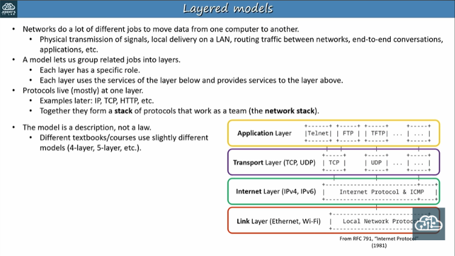
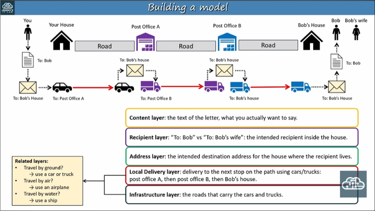

- One of the benefits of the layered systsem is that how the layers work together but remains separate

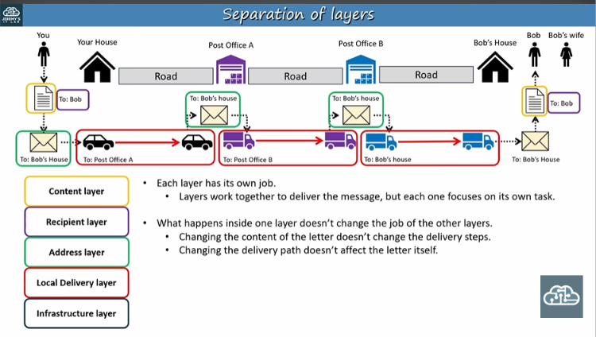
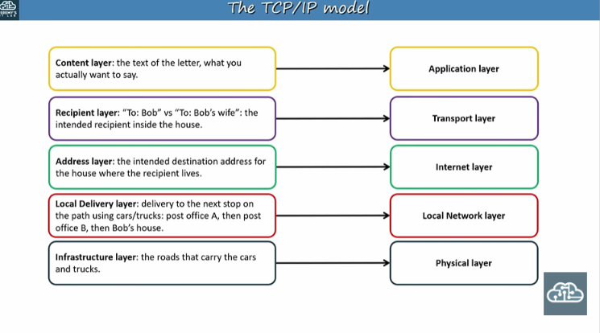

- PC1 wants to access the webapge hosted on the server 1
- There's problem: There are multiple process are running on server1: a web server process and file server process and possibly more. 
- So can PC1 ensure that its request reaches correct process on server 1 => That's the role of the trasnsport layer
- Each process on the server has associated transport port number
- Here a port is just a number to indentify the process running host

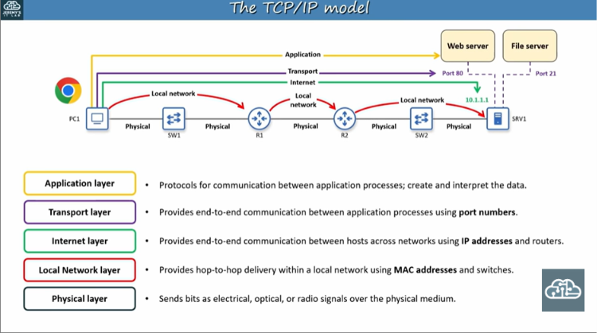
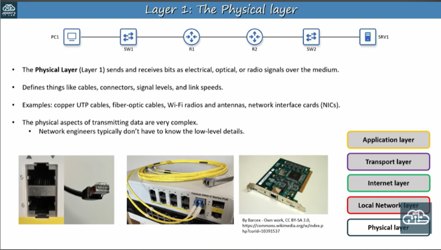
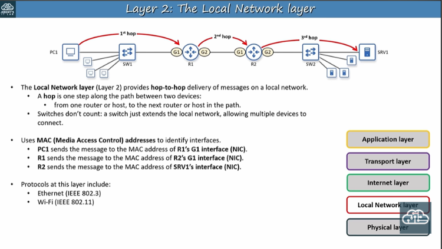
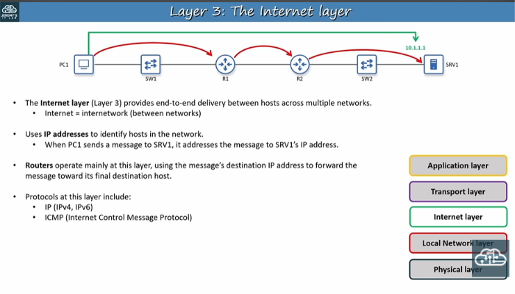
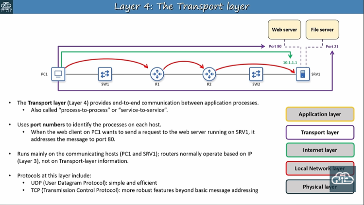

- Yes, a protocol can define how data is encrypted at the sender and decrypted at the receiver, but not every protocol does this.

A protocol is a set of rules that devices follow to communicate. These rules can define data formatting, transmission, error handling, authentication, encryption, and more.

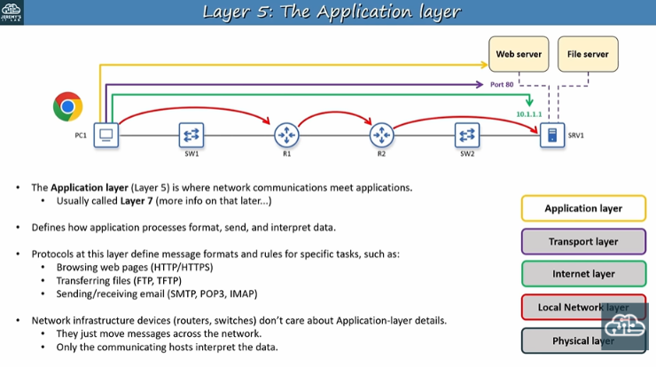

How does a single message include all of this information at onece?

Let's see how these layer combine into stack and data moves through them using encapsulation and decapsulation 

- Encapsulation 
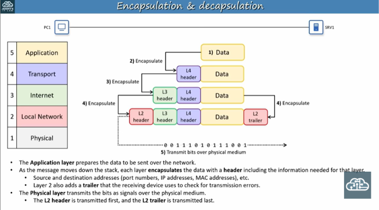

- Decapsulation 
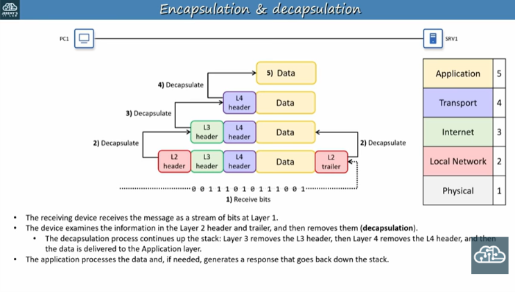

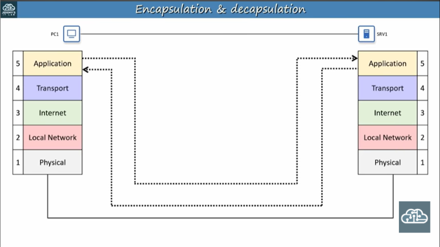
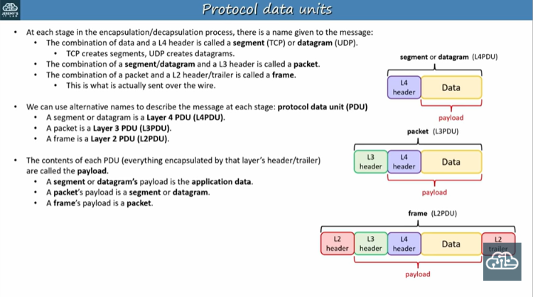
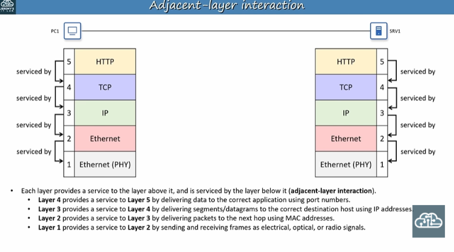

- Same layer interaction 
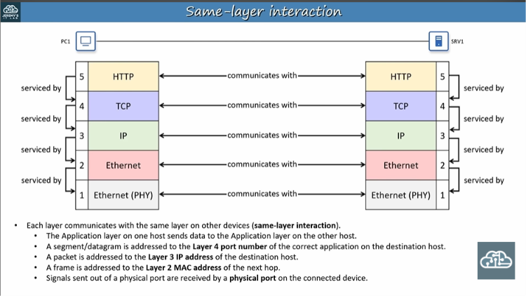
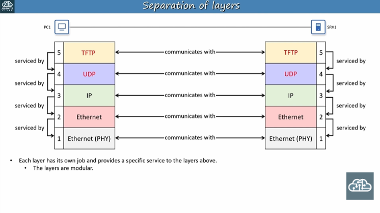
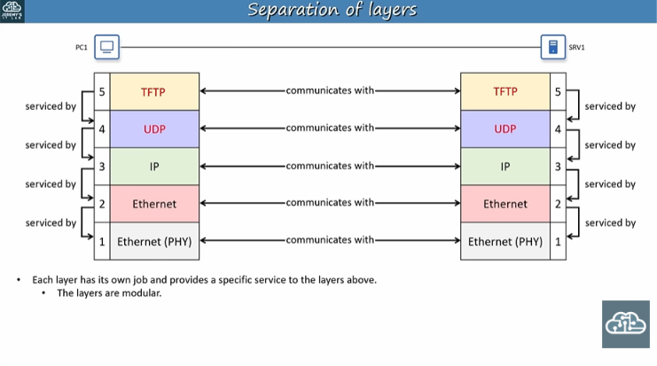
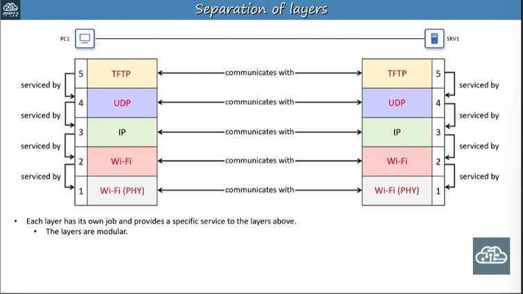
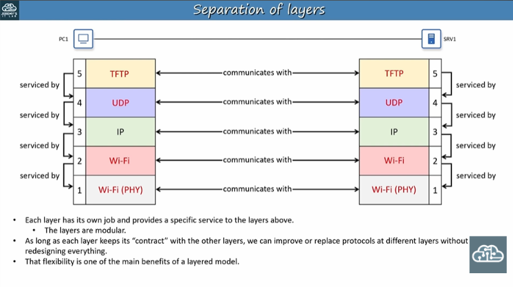
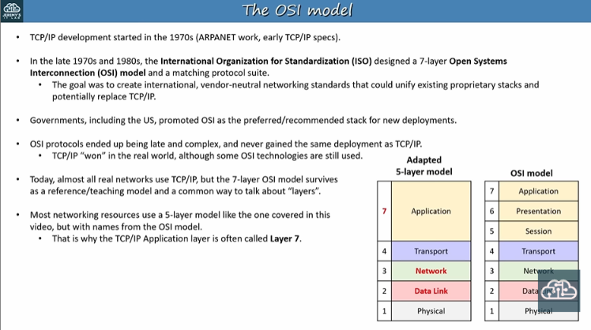
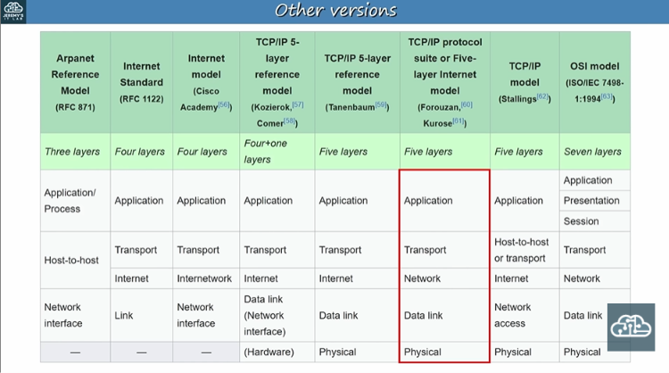
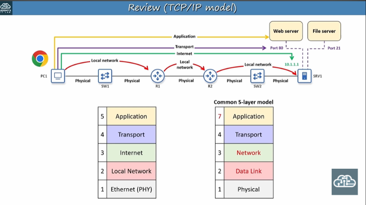

